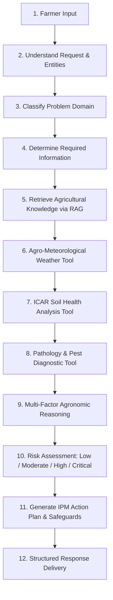

# AgriAgent — AI Agent for Farmer Decision Support
### BharatAgentic Hackathon Backend

AgriAgent is an enterprise-grade agricultural decision support backend implementing a genuine **agentic workflow** (rather than a simple chatbot) to provide diagnostic, agronomic, agro-meteorological, soil, and market recommendations to Indian farmers.

---

## 🌾 Genuine Agentic Workflow



### Why this is genuine Agentic AI (not a simple chatbot):
1. **Domain Classification**: Intelligently classifies farmer queries across plant pathology, entomology, soil fertility, crop phonological stages, and physiological abiotic stress.
2. **Authoritative RAG Retrieval**: Ingests and searches ICAR / TNAU / FAO scientific knowledge over 86 indexed agricultural documents using BM25 tokenization and dense metadata filtering.
3. **Live Agro-Meteorological Integration**: Fetches real-time weather from Open-Meteo, calculates fungal sporulation risk indices, and issues chemical spray advisories.
4. **Soil Health Card Diagnostics**: Compares farmer soil test parameters against ICAR benchmark tables to detect pH imbalances, EC salinity risks, and nutrient deficiencies.
5. **Non-Hallucinatory Diagnostic Safety**: Strictly avoids unsupported disease diagnosis claims; provides indicative confidence percentages and advises physical verification by local Krishi Vigyan Kendra (KVK) officers.
6. **Multi-Factor Synthesis**: Correlates crop phenological vulnerability (e.g. flowering stage) with prevailing weather (e.g. high humidity) and soil weaknesses (e.g. low potassium) to form a unified risk assessment.
7. **Actionable IPM Decision Formulation**: Generates 24h immediate sanitation, cultural methods, biological control, precise chemical formulations, common pitfalls to avoid, and 3/7/14 day monitoring checklists.

---

## 📁 Backend Directory Structure

```
backend/
├── main.py                     # FastAPI application & API router with CORS
├── agent/
│   ├── orchestrator.py         # 11-step AgriAgent orchestrator
│   ├── reasoning.py            # Multi-factor agronomic reasoning engine
│   ├── decision.py             # Action plan & IPM decision engine
│   └── prompts.py              # Domain heuristics, classification & risk rubrics
├── tools/
│   ├── weather.py              # Open-Meteo live API + Indian agro-climatic fallbacks
│   ├── crop_knowledge.py       # Agronomic profiles, growth stages & spacing
│   ├── soil.py                 # ICAR Soil Health Card diagnostics & amendments
│   ├── disease.py              # Multi-criteria disease & pest diagnostic tool
│   ├── market.py               # Mandi modal prices, MSP & harvest advisories
│   └── vision.py               # Computer vision phenotypic leaf screening
├── rag/
│   ├── ingest.py               # Dataset ingestion & chunking pipeline
│   ├── retriever.py            # Agricultural passage search interface
│   └── vectorstore.py          # High-performance in-memory vector/BM25 store
├── data/
│   ├── crops/                  # Rice, Tomato, Chilli, Banana, Coconut, Cotton, Groundnut, Pulses
│   ├── diseases/               # Detailed pathology databases with symptoms & remedies
│   ├── pests/                  # Pest identification, ETL thresholds & IPM controls
│   ├── nutrients/              # NPK, Secondary & Micronutrient deficiency guides
│   └── soil/                   # ICAR Soil test interpretation & amendment benchmarks
├── models/
│   ├── farmer.py               # Farmer profile & location schemas
│   ├── crop.py                 # Comprehensive crop data & lifecycle schemas
│   └── analysis.py             # Request & Response contracts for all endpoints
├── requirements.txt            # Production dependencies
├── test_backend.py             # Unit tests for tools, RAG, and orchestrator
└── test_api.py                 # Integration tests for all 8 HTTP endpoints
```

---

## 🌱 Initial Supported Crops (8 Indian Crops)

- **Rice** (*Oryza sativa*)
- **Tomato** (*Solanum lycopersicum*)
- **Chilli** (*Capsicum annuum*)
- **Banana** (*Musa acuminata / paradisiaca*)
- **Coconut** (*Cocos nucifera*)
- **Cotton** (*Gossypium hirsutum*)
- **Groundnut** (*Arachis hypogaea*)
- **Pulses** (*Cajanus cajan / Vigna mungo*)

---

## 🚀 Quickstart & Server Execution

### 1. Activate Environment & Run Server
```bash
# In the /backend directory:
.\.venv\Scripts\uvicorn.exe main:app --host 0.0.0.0 --port 8000 --reload
```
The server will bind to `0.0.0.0:8000`, making it accessible locally and over the local Wi-Fi network to the Next.js frontend running on another laptop.

### 2. Interactive Swagger UI & OpenAPI Docs
Open `http://localhost:8000/docs` in your browser to inspect and interact with all endpoints.

### 3. Run Backend Verification Tests
```bash
.\.venv\Scripts\python.exe test_backend.py
.\.venv\Scripts\python.exe test_api.py
```

---

## 📡 API Endpoints Overview

| Method | Endpoint | Description |
|---|---|---|
| `GET` | `/health` | System health check and supported crops count |
| `GET` | `/api/crops` | List all 8 supported crops with basic summaries |
| `GET` | `/api/crops/{crop}` | Complete agronomic profile for a specific crop |
| `POST` | `/api/analyze` | **Core Agentic Workflow**: Multi-factor decision support |
| `GET` | `/api/weather?location={loc}` | Real-time weather, fungal disease risk & spray window |
| `POST` | `/api/soil/analyze` | ICAR soil rating, amendment plan & fertilizer schedule |
| `POST` | `/api/health/analyze-image` | Leaf computer vision lesion screening & diagnostics |
| `GET` | `/api/market?crop={crop}&location={loc}` | APMC Mandi modal prices, MSP, and price trends |

---

## 📋 Core Agentic Request & Response

### `POST /api/analyze`

#### Sample Input:
```json
{
  "crop": "Tomato",
  "location": "Vellore, Tamil Nadu",
  "growth_stage": "Flowering / Fruit Setting",
  "symptoms": "Yellowing of lower leaves, brown circular spots with concentric rings",
  "soil": {
    "ph": 6.2,
    "ec": 0.4,
    "organic_carbon": 0.55,
    "nitrogen": 180,
    "phosphorus": 18,
    "potassium": 160
  }
}
```

#### Sample Return:
```json
{
  "summary": "Agronomic assessment for Tomato at Flowering / Fruit Setting in Vellore, Tamil Nadu indicates a MODERATE RISK level. Symptom manifestations correlate primarily with 'Early Blight' (indicative confidence: 88%), under prevailing micro-climate...",
  "possible_issues": [
    {
      "name": "Early Blight",
      "type": "disease",
      "confidence": 0.88,
      "affected_part": "Lower older leaves, stems, fruit calyx",
      "risk_factors": ["Concentric bullseye ring pattern matches Alternaria signature"],
      "description": "Pathogen: Alternaria solani. Dark brown circular spots with distinct concentric rings..."
    }
  ],
  "weather": {
    "temperature_c": 32.4,
    "humidity_pct": 50,
    "rainfall_forecast_mm": 0.0,
    "fungal_disease_risk": "Low",
    "spray_advisory": "Safe for Application"
  },
  "risk_level": "Moderate",
  "reasoning_factors": [
    "Phenological Vulnerability: Tomato at 'Flowering / Fruit Setting' is in a critical reproductive phase where photosynthetic leaf loss directly curtails floral fertilization.",
    "Weather Interaction: Warm and dry ambient conditions suppress bacterial rots but require monitoring for vector surges.",
    "Soil Health Context: Favorable soil chemical balance (Score: 80/100, pH 6.2) provides strong baseline root nutrition.",
    "Diagnostic Correlation: Observed symptom expressions align closely with 'Early Blight' (Estimated confidence: 88%)."
  ],
  "recommendations": [
    "Immediate Sanitation (Next 24h): Prune and safely bag all severely infected lower leaves...",
    "Foliar Fungicide (Targeted): Spray Azoxystrobin 23% SC @ 1.0 ml/litre or Mancozeb 75% WP @ 2.0 g/litre...",
    "Bio-control & Organic Option: Foliar application of Pseudomonas fluorescens @ 5 g/litre...",
    "Nutrient Management: Increase recommended chemical Nitrogen fertilizer dose by 25%...",
    "Weather Spray Window: Current advisory is 'Safe for Application'. Spray early morning (6:30-9:30 AM)."
  ],
  "things_to_avoid": [
    "DO NOT apply additional chemical Urea or excess Nitrogen fertilizer right now...",
    "DO NOT use overhead sprinklers or hose watering that wets the canopy...",
    "DO NOT mix chemical copper fungicides with bio-control agents (Trichoderma/Pseudomonas)...",
    "DO NOT spray foliar agrochemicals during midday heat (>32°C)...",
    "DO NOT harvest marketable fruits within the designated Pre-Harvest Interval (PHI)..."
  ],
  "monitoring_steps": [
    "Day 3 Milestone: Inspect treated plants for arrest of lesion margins...",
    "Day 7 Milestone: Evaluate new leaf flushes and flower clusters...",
    "Day 14 Milestone: Assess overall canopy vigor, fruit set stability, and soil moisture consistency..."
  ]
}
```

---

## 🌐 Connecting Next.js Frontend from Another Laptop

The backend is configured with permissive CORS (`allow_origins=["*"]`) and binds to `0.0.0.0:8000`.

To connect from another laptop on the same local Wi-Fi:
1. Find the host laptop's local IP address (e.g. `192.168.1.15`).
2. In the Next.js frontend `.env.local`:
   ```env
   NEXT_PUBLIC_API_URL=http://192.168.1.15:8000
   ```
3. Test connectivity in your browser: `http://192.168.1.15:8000/health`.

---

## 🔬 Authoritative Knowledge Sources
- **ICAR**: Indian Council of Agricultural Research (Crop Protection & Soil Testing Manuals)
- **TNAU**: Tamil Nadu Agricultural University Agritech Portal
- **FAO**: Food and Agriculture Organization Crop Ecological Guidelines
- **CIBRC**: Central Insecticides Board & Registration Committee (Safe Dosage & PHI Standards)
